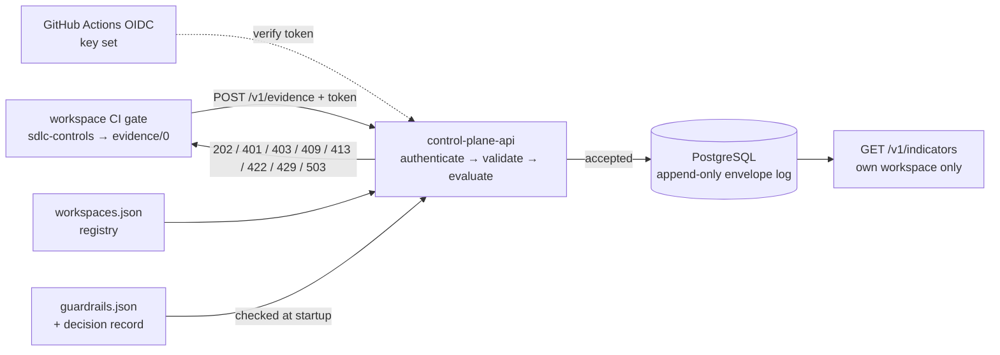

# SDLC Control Plane

[](https://github.com/codeaiforge/sdlc-control-plane/actions/workflows/ci.yml)
[](LICENSE)

A federation layer for engineering governance: governed workspaces submit the evidence their SDLC gates produce, and the control plane authenticates it, checks it against an approved guardrail policy, and keeps it. It is deliberately not a portfolio-management, finance, or autonomous decision-making system.

Reference implementation, not a product, and not deployed anywhere: no deployment URL is published, and the shipped workspace registration is a suspended example. Its HTTP contract is versioned in [openapi.json](packages/control-plane-api/openapi.json) and is pre-1.0.

## Who this is for

Organisations with many engineering workspaces that each run their own change controls, and a governance function that has to see across them without taking them over. The problems it addresses:

- Each workspace's gate produces evidence, and nothing collects it in one place.
- Evidence arrives from anyone who can reach an endpoint, with no proof of which workspace sent it.
- A central policy is cited as "approved" with nothing that says who approved it, or when.
- AI-assisted changes are counted as clean because the record never said they were assisted.

It is the central half of [git-native-sdlc-controls](https://github.com/codeaiforge/git-native-sdlc-controls): that tool tiers each change and writes an `evidence/0` record; this one receives those records from many repositories.

## What it does

| Capability                  | What it does                                                                                                                                                                                                                                                                                                                                                                                         |
| --------------------------- | ---------------------------------------------------------------------------------------------------------------------------------------------------------------------------------------------------------------------------------------------------------------------------------------------------------------------------------------------------------------------------------------------------- |
| **Workload authentication** | Every route but `GET /health` needs a GitHub Actions OIDC token bound to a registered workspace, and each caller sees only its own workspace ([ADR-0003](docs/adr/0003-github-actions-oidc-workload-authorization.md)).                                                                                                                                                                              |
| **Evidence intake**         | `POST /v1/evidence` validates the record against `evidence/0`, evaluates it against the guardrail policy, and stores an accepted record durably in PostgreSQL. A replay is answered as a duplicate, across restarts and processes ([ADR-0002](docs/adr/0002-append-only-evidence-envelope-log.md)).                                                                                                  |
| **Guardrail policy**        | One `guardrails/0` policy, read at startup from [config/control-plane/guardrails.json](config/control-plane/guardrails.json). The service refuses to start on a policy whose approval is incomplete or a placeholder, and a test resolves the approval to a decision record in [config/control-plane/decisions/](config/control-plane/decisions/). Every acceptance is stamped with the policy's id. |
| **AI provenance**           | `ai_assisted` is a required boolean, and an AI-assisted record must name its tool, or it gets `needs-remediation` (CAF-SDLC-010).                                                                                                                                                                                                                                                                    |
| **Indicators**              | `GET /v1/indicators` gives descriptive engineering indicators over the caller's own accepted evidence. No cross-workspace view is served ([ADR-0003](docs/adr/0003-github-actions-oidc-workload-authorization.md)).                                                                                                                                                                                  |

Every record is the submitter's own claim, bound to the identity that sent it, not a verification by the control plane ([ADR-0004](docs/adr/0004-evidence-recorded-as-identity-bound-self-attestation.md)).

## How it works



A workspace's gate posts its evidence record with a workload token. The API verifies the token against GitHub's key set and the workspace registry, validates the record against the contract, evaluates it against the guardrail policy, and appends an accepted record to the envelope log; a refusal is answered and never stored. The target architecture, with the portfolio and integration layers not yet built, is in [docs/architecture/overview.md](docs/architecture/overview.md); every project is an Nx project under `packages/`, and the API is the only deployable.

## Quick start

Requires Node.js 20 or later.

```sh
corepack enable
pnpm install
git config core.hooksPath .githooks   # enables the commit-msg provenance check
pnpm test
pnpm nx graph
```

`pnpm test` needs no database. CI also runs `pnpm audit`, `pnpm format:check`, `pnpm test:controls`, `pnpm test:integration` (against PostgreSQL, below) and `pnpm build`; run them before pushing.

### Running the service

The service runs only on its durable store, PostgreSQL 16, and refuses to start without it. Once per cluster, as an administrator, create the roles and the database, then give each role a password out of band; then apply the schema as `evidence_owner` and serve as `evidence_app`:

```sh
PGHOST=... PGUSER=<admin> PGPASSWORD=... PGDATABASE=postgres pnpm nx run evidence-store:bootstrap --database sdlc_control_plane
#   an admin that is not a superuser (a managed service's) stops here with 42501 once the roles exist:
#   as that admin, GRANT evidence_owner TO <admin> WITH SET TRUE; then run bootstrap again
#   then, as the administrator in psql: \password evidence_owner (and evidence_app, evidence_retention, evidence_audit);
#   not ALTER ROLE ... PASSWORD, which leaves the plaintext in server logs and psql history
PGHOST=... PGUSER=evidence_owner PGPASSWORD=... PGDATABASE=sdlc_control_plane pnpm nx run evidence-store:migrate
PGHOST=... PGUSER=evidence_app PGPASSWORD=... PGDATABASE=sdlc_control_plane pnpm start:api
```

Connection settings are `PGHOST`, `PGPORT`, `PGDATABASE`, `PGUSER`, `PGPASSWORD` and `PGSSLROOTCERT`, and nothing else. Without `PGSSLROOTCERT` the server's certificate is checked against Node's default CAs, which `NODE_EXTRA_CA_CERTS` extends; set `PGSSLROOTCERT` to trust only your database's CA. The service refuses to start, with a message naming the reason, on an unusable guardrail policy, an unusable configuration, an unreachable server, a non-loopback host without verified TLS, a database role the startup check refuses (an elevated attribute, membership of any other role, ownership of the database or of anything in the `evidence` schema, or a grant that could change or remove a row of the envelope log or its redaction table, or set a row's `received_at` or `redacted_at`), or a schema that is not the one it bundles. A TLS failure - no TLS on the server, a missing or wrong CA, a certificate for another name - is reported as `database-unreachable`, the same line as a wrong password: the service refuses, but does not say which. What the roles may do, and what is left to whoever deploys it, is the `Access control` row of [docs/specs/stack.md](docs/specs/stack.md).

The HTTP surface — routes, statuses and bodies — is [packages/control-plane-api/openapi.json](packages/control-plane-api/openapi.json), and a contract test fails when it and the seam disagree. Every hop that carries the token needs TLS, and so does the database connection unless it is on loopback. The shipped `config/control-plane/workspaces.json` registers one example workspace, suspended, so out of the box no token is authorized.

## The honest ceiling

- **Evidence is self-attested.** The control plane proves who sent a record, not that what it says is true: a workspace's list of verified controls is its own claim ([ADR-0004](docs/adr/0004-evidence-recorded-as-identity-bound-self-attestation.md)). Whether a change was AI-assisted is likewise the submitter's word; the control plane only refuses a record that does not say.
- **An approval is checked for form, not for a person.** Startup refuses an incomplete approval and a fixed list of placeholder words; a test resolves the approval to a decision record whose rules and approval line match. Neither establishes that a person decided: the record and the policy can be written by the same person, and a policy edited on a deployed host is not checked against any record (threat model RR-9).
- **One approver.** The project is maintained by one person, so no second approver, `CODEOWNERS` or branch protection can be required yet (RR-1).
- **Per-process limits.** The submission quota and read timeouts are per process; a restart resets the window (RR-6).
- **Not yet built.** The 90-day retention job (task 2.5), operator telemetry and health (2.3), the workspace-side evidence adapter (3.1), and any portfolio or ALM integration (3.2). The policy is applied, not published to workspaces: no route serves it (RR-3).

Every accepted risk, with who accepted it and when it is reviewed, is in the residual-risk table of [docs/architecture/threat-model.md](docs/architecture/threat-model.md).

## Scope: what is here, and what deliberately is not

| Concern              | This control plane does                                                                  | It does not do                                 |
| -------------------- | ---------------------------------------------------------------------------------------- | ---------------------------------------------- |
| Team / ART execution | Receives SDLC gate evidence and provenance from registered workspaces                    | Replace the workspace CI/CD pipeline           |
| ART coordination     | Registers workspaces; cross-workspace indicators are not served in the MVP (ADR-0003)    | Plan work or resolve dependencies for teams    |
| Large Solution       | Keeps evidence traceable to its workspace, change and policy; no MBSE integration yet    | Own solution intent or supplier management     |
| Portfolio            | Applies one approved guardrail policy and stamps it on every decision; no indicator view | Make investment, staffing, or budget decisions |

## Tests

```sh
pnpm test               # unit tests, every project, no database
pnpm test:integration   # against a real PostgreSQL 16, below
pnpm test:controls      # repository controls: ADRs, threat model, policy, graph
```

Unit tests are co-located with the code in each project under `packages/`. A contract test holds the seam to `openapi.json`. The security controls each have a test that fails when the control is removed: the provenance rule, the `blocked_tiers` rule, and the startup refusal of an unusable policy among them. The repository controls check that every accepted ADR carries a dated approval line, that each threat-model mitigation marked in place names an evidence path that exists, and that the shipped guardrail policy, its validator, the evaluator and its decision record agree.

The integration tests run against a real PostgreSQL 16 server, never a simulator, and fail rather than skip without one. Locally:

```sh
docker run --rm -d --name evidence-pg -e POSTGRES_PASSWORD=postgres -p 127.0.0.1:5432:5432 postgres:16-alpine
PGHOST=127.0.0.1 PGUSER=postgres PGPASSWORD=postgres pnpm test:integration
docker stop evidence-pg
```

The `PG*` variables name a cluster administrator; the harness creates the service's roles and a fresh database per test. Use `127.0.0.1`, not `localhost`: any host that is not a literal loopback address requires verified TLS. Point it only at a throwaway cluster, never one that serves the control plane: the roles are cluster-wide with fixed names, and the harness resets their passwords.

## Repository authority

1. Nx project graph — deployable and library boundaries
2. `docs/` — architecture, decisions, contracts, implementation plan
3. `config/` — the approved guardrail policy, its decision records, and sample registration data
4. `AGENTS.md` — contributor adapter; it cannot redefine the preceding sources

Delivery is planned in [docs/specs/implementation-roadmap.md](docs/specs/implementation-roadmap.md), and current status is in the latest `docs/specs/sprint-*-progress.md`. The workspace adapter and CI approach are informed by [ai-ready-nx-workspace](https://github.com/codeaiforge/ai-ready-nx-workspace). Evidence shape and tier-control semantics align to [git-native-sdlc-controls](https://github.com/codeaiforge/git-native-sdlc-controls), whose `evidence/0` contract remains experimental before v1.0.

## Maintainer

Built and maintained by [CodeAIForge](https://codeaiforge.com) — open an issue, or get in touch if you want help running governance like this across real workspaces.

## License

Licensed under the [Apache License, Version 2.0](LICENSE).
