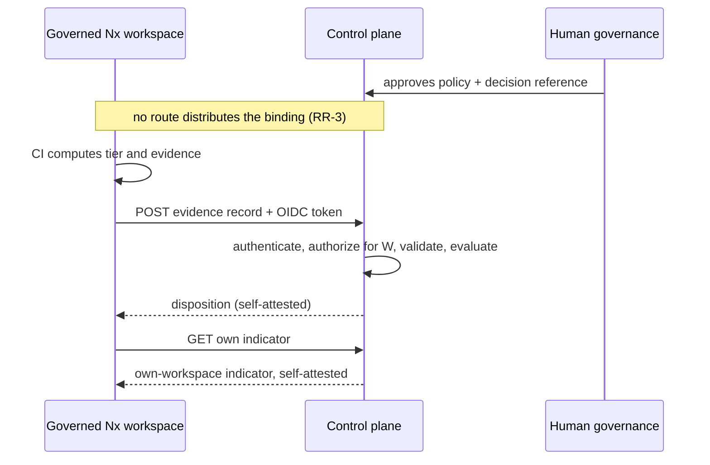

# Federation contracts

## Where the contract lives

[`packages/control-plane-api/openapi.json`](../packages/control-plane-api/openapi.json) is the source of truth for the HTTP surface: which routes exist, which status codes each one can answer with, which fields every request and response body carries, and the shape of the error envelopes. It also records, in prose, the places where the running seam diverges from what the document's own vocabulary would otherwise imply, and what the 202 on evidence intake does and does not promise.

[`packages/control-plane-api/src/openapi.contract.test.mjs`](../packages/control-plane-api/src/openapi.contract.test.mjs) is what holds that document to the seam. It compares the documented routes and statuses against the route table the seam dispatches on and against the status literals in the seam's own source, and validates every observed response body against the schema the document names for that exact path, method and status. A document that over-claims fails there rather than in review.

This page carries the reasoning behind the contracts. It deliberately does not restate their fields: a second field list is a second source of truth, and nothing would notice the two drifting apart.

## Inbound: SDLC evidence

Each workspace posts an `evidence/0`-compatible record produced by `git-native-sdlc-controls`. This scaffold validates the minimum stable subset and tolerates unrecognised additive fields on a supported version; the fields themselves are the `EvidenceRecord` schema in `openapi.json`. Unknown fields are preserved through storage as well as validation: since task 2.2 the record is stored as `jsonb` in the PostgreSQL envelope log [ADR-0002](adr/0002-append-only-evidence-envelope-log.md) decides (Accepted at Gate 2, 2026-10-01), so an additive field survives the round trip. The round trip is value equality, not byte equality: `jsonb` keeps every value and does not keep key order, so a record is read back as the same JSON value with its keys possibly reordered. Key order is not significant on the way in either: two submissions that differ only in the order their keys were written are the same submission, a duplicate rather than a conflict (`openapi.json` divergence 6). A record holding U+0000, or a string or key that is not well-formed UTF-16, is refused with 400 before policy is evaluated, because no durable store holds either unchanged (divergence 5).

The contract is rejected when its schema version is not `evidence/0`; accepting a later shape on a guess can under-report a control failure.

## Inbound: workspace registration

Registration binds a repository to the ownership and value-stream context the control plane records against it; the fields are the `Workspace` schema in `openapi.json`, at `workspace-registry/1` since task 2.1. It is configuration, reviewed like any other control input. A registration is not an assertion that the control plane can query that repository.

A registration now also carries the workload binding, `workload_identity`: the issuer and the numeric `repository_owner_id` and `repository_id` a GitHub Actions OIDC token must carry, the events it may be minted for, and optional workflow pins ([ADR-0003](adr/0003-github-actions-oidc-workload-authorization.md)). That binding is the only thing a token is matched against; nothing in a request body, and no repository name, decides which workspace a submission speaks for. Unlike the rest of the registration, the `workload_identity` block is closed: an unrecognised field in it is refused at load. That is an exception to NFR-1.1's tolerance of additive fields, accepted at task 2.1's Phase ② gate (founder, 2026-10-07), because a misspelled pin field would otherwise load silently and pin nothing.

## Outbound: guardrail binding

`guardrails/0` is the guardrail policy the control plane reads when it starts, from [`config/control-plane/guardrails.json`](../config/control-plane/guardrails.json): a policy identifier, an effective date, an approving decision reference, and deterministic technical rules. The policy may block an evidence record from satisfying the engineering policy; it may not make a portfolio decision. No route serves it, so a governed workspace has no published policy contract to read (threat model RR-3).

Its field list is not restated here: it is `validateGuardrailPolicy` in [`packages/contracts/src/schema.mjs`](../packages/contracts/src/schema.mjs), and the service refuses to start, and its request handler refuses to be built, on a policy that fails it. The schema is closed at every level — an unrecognised field at the top level, in `approval` or in `rules` is refused. That is a second exception to NFR-1.1's tolerance of additive fields, accepted at task 2.4's Phase ① gate (founder, 2026-10-22), because a misspelt rule would otherwise load and enforce nothing; `guardrails/0` is configuration this control plane owns and reads, not a contract another system produces. [`tools/sdlc-controls/policy-conformance.test.mjs`](../tools/sdlc-controls/policy-conformance.test.mjs) holds the shipped file, the validator and the rules the evaluator reads together, so those three cannot drift apart without it failing; of this section it checks only a few phrases, among them that it names the validator, and that every identifier it sets in code font is the validator or a field the validator knows.

The approval is checked twice, for different things. At start-up, for form: the `approval` block is complete, its timestamps are real UTC times, the approval is not dated after the policy takes effect, and neither the decision reference nor the approver reads as a placeholder. In the repository, by the same test: the decision reference names a decision record in [`config/control-plane/decisions/`](../config/control-plane/decisions/) whose approval line and rules match the shipped policy. Neither check establishes that a person decided: the record and the policy can be written by the same person, and a policy edited on a deployed host is not checked against any record (threat model RR-9). The provenance rule — an AI-assisted record must name its tool — must be on: a policy that turns it off does not start.

An earlier version of this page said that surface was coming in Sprint 2. It is not. Policy administration is threat-modelled in roadmap task 1.3, which produces a threat model rather than a route, and **no scheduled task builds the surface** — 2.1 is identity, 2.2 is evidence intake, 2.3 is operator telemetry, and 2.4 hardens the policy's approval and provenance rules without serving the policy. Gate 2 (2026-10-01) resolved the overstatement by rewording Sprint 2's definition of done: policy changes are queryable from the git history of `config/control-plane/**`. Today the audit trail for a policy change is the reviewed commit to [`config/control-plane/`](../config/control-plane/): attributed but unverified, gated and evidence-producing, but readable only with the repository and `git log`, and exposed by no route. [ADR-0002](adr/0002-append-only-evidence-envelope-log.md) records that gap; Gate 2 chose to rewrite the bullet rather than add a task.

## Evidence lifecycle

Since task 2.1 no route returns an indicator, a registration list or a traceability view to human or organisational governance: every read is scoped to the calling workload's own workspace, and the organisation-wide view is lost in the MVP by the founder's decision ([ADR-0003](adr/0003-github-actions-oidc-workload-authorization.md) › Route authorization). Every disposition and indicator is labelled `self-attested`: it rests on the workload's own claims, bound to its verified run identity ([ADR-0004](adr/0004-evidence-recorded-as-identity-bound-self-attestation.md)).
