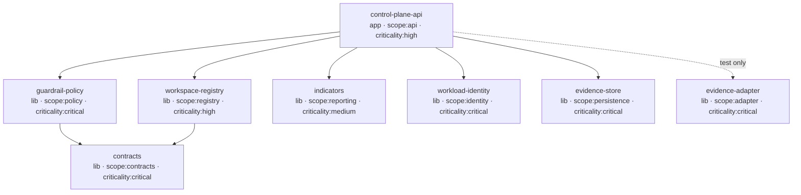

# Components

The eight Nx projects under `packages/`, each with its type and its `scope:*` and
`criticality:*` tags, and every edge of the project graph. The nodes and edges are exactly
those of `nx graph`. Left out: targets, files, the workspace-level components the component map
adds (`tools/sdlc-controls/generate-component-map.mjs`), and every external system.



**Legend.** An arrow points from a project to one it imports. Every edge is an
`implicitDependencies` entry in the importing project's `project.json`. Nx does not resolve the
deep relative imports these packages use, so the declared list is the graph, and
`tools/sdlc-controls/graph-fidelity.test.mjs` holds it equal to the imports. The dotted edge is
imported only by a test: `control-plane-api`'s end-to-end test
`evidence-adapter.integration.mjs` runs the adapter, and the service does not import it.
`contracts` sits at fan-in 2. The component map marks a project `shared` at 3.

## Regenerating

The diagram is written by hand from the graph, and
`tools/sdlc-controls/diagrams-conformance.test.mjs` fails when it stops matching. That test
compares the nodes, types, tags and edges with every `packages/*/project.json`, and the dotted
style with which files import the target. After changing a project's tags or dependencies, read
the graph and redraw:

```sh
NX_DAEMON=false pnpm exec nx graph --file=/tmp/graph.json
node -e 'const {graph} = require("/tmp/graph.json");
for (const [n, v] of Object.entries(graph.nodes)) console.log(n, v.type, v.data.tags.join(" "));
for (const [s, es] of Object.entries(graph.dependencies)) for (const e of es) console.log(s, "->", e.target, e.type);'
```

## Sources

- `packages/control-plane-api/project.json`, `packages/guardrail-policy/project.json`,
  `packages/workspace-registry/project.json`, `packages/indicators/project.json`,
  `packages/workload-identity/project.json`, `packages/evidence-store/project.json`,
  `packages/evidence-adapter/project.json`, `packages/contracts/project.json`
- `nx graph` at `b81ad28`: 8 nodes, 8 edges, every edge `implicit`
- `tools/sdlc-controls/graph-fidelity.test.mjs:54-63` (the reviewed fan-in)
- `packages/control-plane-api/src/evidence-adapter.integration.mjs` (the only importer of the
  adapter)
- `config/sdlc-controls/criticality-tags.md`
- `docs/architecture/overview.md` › Runtime boundaries
