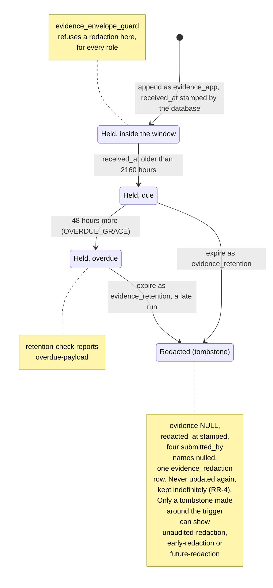

# Evidence lifecycle

The life of one row of `evidence.evidence_envelope`, from the append that creates it to the
tombstone it ends as. It shows where `retention-check` reports each violation it can name. It
leaves out the request that led to the append ([evidence-submission.md](evidence-submission.md))
and the database roles' full grants.

**Legend.** Every state is the same row. "Held" means `evidence` is not null and `redacted_at`
is null; the pairing CHECK `evidence_envelope_redaction_pair` allows only that or the
tombstone. There is no final state, because no granted role holds DELETE or TRUNCATE on the log.
The table's owner and a superuser are outside that: the owner can grant itself back what the
migration revoked, and a superuser needs no grant.

What each transition is, in the code:

- **Append.** `evidence_app` may INSERT only the columns without the two timestamps, so
  `received_at` is the column default, `statement_timestamp()`. A replay is answered `duplicate`
  and a different body under the same `(workspace_id, change_id)` is `conflict`; neither changes
  the row. A replay of a tombstone is a `duplicate` too.
- **Due.** The window is `RETENTION_WINDOW = '2160 hours'`: 90 days of 24 hours, whatever the
  session's TimeZone. `expire` selects `received_at < statement_timestamp() - 2160 hours`. The
  guard refuses `received_at >= statement_timestamp() - 2160 hours`. They read the same clock in
  the same statement, so a row `expire` picks is never refused.
- **Redaction.** `expire`'s only statement sets `evidence = NULL`. The trigger
  `evidence_envelope_guard` (function `evidence.guard_envelope_update()`, SECURITY DEFINER) does
  the rest: it keeps every identity column, nulls the four `submitted_by` names, stamps
  `redacted_at`, and inserts the `evidence_redaction` row with `redacted_by = session_user`. It
  refuses any other update, for every role.

What `retention-check` (as `evidence_audit`) reports, by the `VIOLATIONS` names:

| Violation             | Which rows                                                         | How it can arise                                                                                                    |
| --------------------- | ------------------------------------------------------------------ | ------------------------------------------------------------------------------------------------------------------- |
| `overdue-payload`     | held, `received_at` past `2160 hours` + `48 hours`                 | `expire` did not run, failed, or skipped a locked row                                                               |
| `unaudited-redaction` | tombstone with no `evidence_redaction` row                         | an owner or a superuser bypassing the trigger                                                                       |
| `early-redaction`     | tombstone with `redacted_at - received_at <= 2160 hours`           | the same                                                                                                            |
| `future-redaction`    | tombstone with `redacted_at` later than the check's clock          | the same                                                                                                            |
| `future-receipt`      | any row with `received_at` later than the check's clock            | an owner or a superuser rewriting `received_at`                                                                     |
| `guard-absent`        | none: the trigger `evidence_envelope_guard` is missing             | dropped, or never installed                                                                                         |
| `guard-replaced`      | none: a pinned attribute differs from what the migrations make     | the trigger, its function, a column or a constraint was changed, or another trigger, rule or inheriting table added |
| `guard-disabled`      | none: the trigger exists but would not fire in an ordinary session | disabled, or set to fire only under replication                                                                     |

`future-receipt` can be any row, held or redacted, and the three `guard-*` states describe the
table, not a row, so none of the four is drawn on a state. The check sees none of this as
history: it reads one snapshot, and it says on every run what it cannot see.

## Sources

- `packages/evidence-store/migrations/0001-evidence-envelope.sql:17-36` (the log, the
  `received_at` default, the pairing CHECK), `:42-47` (`evidence_redaction`), `:110-112` (the
  trigger), `:125-138` (the grants), `:143-144` (no DELETE or TRUNCATE)
- `packages/evidence-store/migrations/0002-retention-window.sql:18-69` (the guard with the
  window), `:45-48` (the early-redaction refusal)
- `packages/evidence-store/src/expire.mjs:19-27` (`RETENTION_ROLE`, `RETENTION_WINDOW`),
  `:88-119` (`expire`)
- `packages/evidence-store/src/retention-check.mjs:27-49` (`AUDIT_ROLE`, `OVERDUE_GRACE`,
  `VIOLATIONS`), `:152-157` (guard states), `:284-333` (the counts and the violations)
- `packages/evidence-store/src/postgres-store.mjs:115-155` (appended, duplicate, conflict)
- `docs/adr/0002-append-only-evidence-envelope-log.md` › Retention: 90 days from `received_at`
- `docs/architecture/threat-model.md` (RR-4, ABU-12, MIT-15)
- `README.md` › Retention
