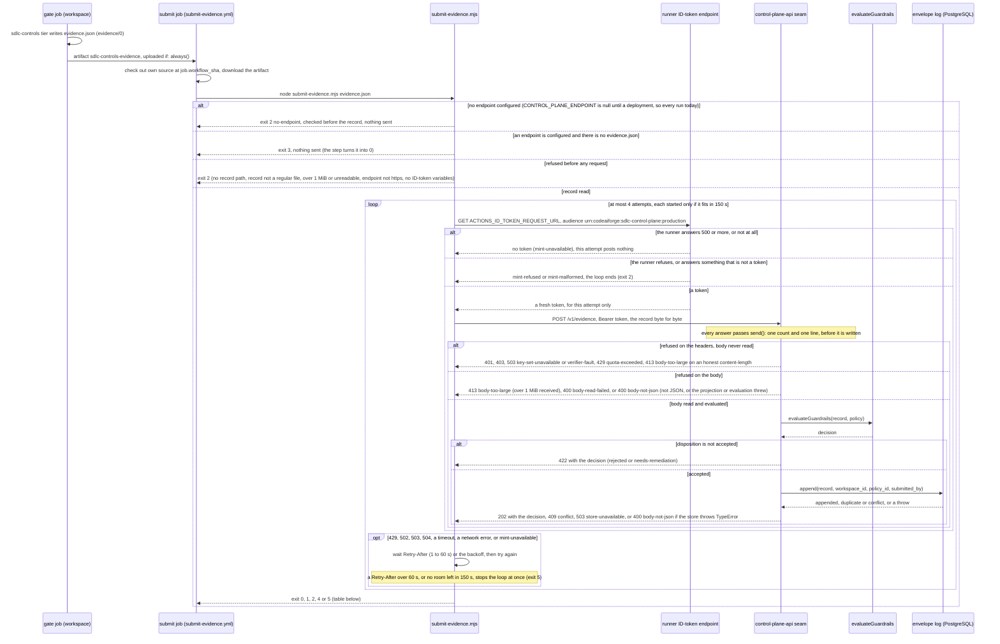

# Evidence submission

One submission, from a workspace's gate to the stored envelope: the gate writes its `evidence/0`
record, the pinned submit job runs the adapter, and the adapter mints a token and posts the
record until it gets an answer it does not retry. It names only some refusals' reason codes
([route-authorization.md](route-authorization.md) has them all), and leaves out the key-set
fetch and how the seam closes a refused connection.

**Exit codes** (`EXIT` in `submit-evidence.mjs`). The job fails on anything but 0 and 3.
`main` checks the endpoint first, before it looks for the record: `CONTROL_PLANE_ENDPOINT` is
`null` until the release that names a deployment sets it, so today every run ends at exit 2
`no-endpoint`, with or without a record, and nothing reaches the loop.

| Exit | When                                                                                                                                                                                                                                                                                                                                                                  |
| ---- | --------------------------------------------------------------------------------------------------------------------------------------------------------------------------------------------------------------------------------------------------------------------------------------------------------------------------------------------------------------------- |
| 0    | 202 with a decision: appended or duplicate, which look the same on the wire                                                                                                                                                                                                                                                                                           |
| 1    | 422: a disposition other than accepted; nothing stored                                                                                                                                                                                                                                                                                                                |
| 2    | no endpoint configured (`no-endpoint`, checked first); refused before any request (`no-record-path`, `record-not-regular`, `record-too-large`, `record-unreadable`, `endpoint-not-https`, `no-id-token-variables`); the runner would not mint (`mint-refused`, `mint-malformed`, `mint-endpoint-not-https`); or Node refused to build the request (`request-invalid`) |
| 3    | an endpoint is configured and there is no `evidence.json`: the gate never reached a decision                                                                                                                                                                                                                                                                          |
| 4    | 400, 401, 403, 409, 413, any 3xx (never followed), a 202 without a decision, a submit answer over 64 KiB (`response-too-large`), any other status (a control-plane 500 is not retried)                                                                                                                                                                                |
| 5    | still 429, 502, 503, 504, a timeout or a network error, or `mint-unavailable` (the runner answered 500 or more, or did not answer), when the 4 attempts or the 150 s budget run out, or at once on a Retry-After over 60 s                                                                                                                                            |

**Telemetry (task 2.3).** The seam's `send()` records every response before writing it. That
is one count by route, status and outcome, and one stderr line: `accepted` with `appended` or
`duplicate`, or `refusal` with its reason. A 422's line names the disposition, never the reasons.

## Sources

- `.github/workflows/sdlc-controls.yml:27-33` (`tier --evidence-out evidence.json`, upload
  `sdlc-controls-evidence` with `if: always()`). This is this repository's own gate, the shape a
  workspace's gate takes; it does not call the reusable workflow itself.
- `README.md` › Wiring a workspace (the calling job, and the per-run `--change-id`)
- `.github/workflows/submit-evidence.yml:23-62` (`!cancelled()`, own-source checkout at
  `job.workflow_sha`, `download-artifact`, exit 3 turned into 0)
- `packages/evidence-adapter/src/submit-evidence.mjs:30-80` (`AUDIENCE`, `MAX_ATTEMPTS`,
  `TOTAL_BUDGET_MS`, `EXIT`, `RETRYABLE`), `:177-212` (`mintToken`), `:243-306` (`attemptOnce`),
  `:314-352` (the retry loop), `:474-564` (`main`, the local refusals)
- `packages/control-plane-api/src/main.mjs:146-179` (`send`), `:217-244` (headers-only refusals),
  `:318-427` (`POST /v1/evidence`)
- `packages/control-plane-api/src/telemetry.mjs:194-211` (`record`)
- `packages/evidence-store/src/postgres-store.mjs:85-155` (`append`: appended, duplicate,
  conflict)
- `docs/contracts.md` › Producer: the evidence adapter
- `docs/adr/0003-github-actions-oidc-workload-authorization.md` › Wire statuses
- `docs/adr/0002-append-only-evidence-envelope-log.md`
