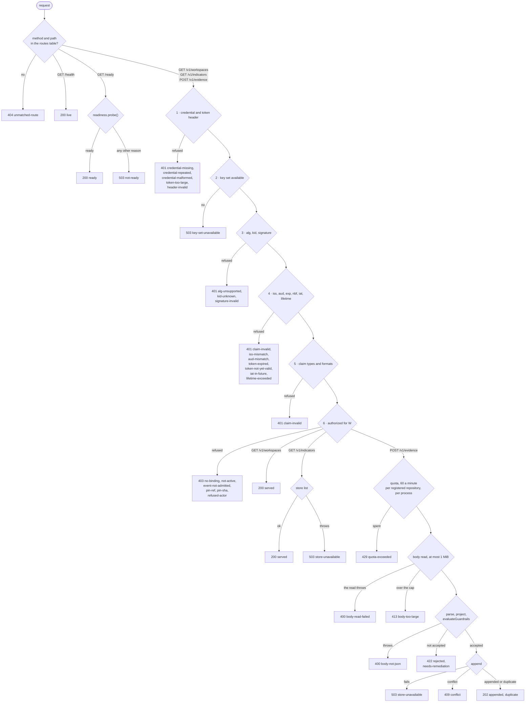

# Route authorization

How the seam admits one request, from the route match to the response it sends. Every leaf is
the status on the wire and the outcome code the seam logs and counts for it. The two probe routes
read no credential (ADR-0005). Every other route goes through ADR-0003's steps 1 to 6 before a
body byte is read. Left out: the respond-then-destroy close, the key-set fetch behind step 2,
and the `Expect: 100-continue` handling.

**Legend.** A diamond is a decision, the stadium the incoming request, and a rectangle a response:
its status, then each outcome code that can come with it. Steps 1 to 5 are `authenticate`, step 6
is `authorizeFor`. They are ADR-0003's validation order, and the first failure answers. Step 1
reads the `Authorization` credential and the token's JOSE header: `header-invalid` is that
header, not the HTTP one. The quota is keyed by `bindingKey`, the issuer, owner id and
repository id of one registration.

Not drawn, because they can follow any box above:

- `503 verifier-fault`: the authenticator threw at any of steps 1 to 5. That is the control
  plane's fault, so it is answered 503, not 401. On the wire it carries step 2's body,
  `{"error":"key set unavailable"}`; only the outcome code tells the two apart.
- `503 handler-fault`: any route threw, or returned without answering. A probe's 503 keeps the
  probe's status-only body.
- A store `TypeError` during the append is the caller's record, not the store, and is answered
  `400 body-not-json`.

## Sources

- `packages/control-plane-api/src/main.mjs:252-428` (the routes table and each handler),
  `:475-479` (404 before any credential), `:491-517` (probes skip authentication, the backstop
  and catch-all), `:202-244` (step 6 and the headers-only refusals)
- `packages/workload-identity/src/authenticate.mjs:11-22` (steps 1 to 5 and their statuses),
  `:43-119`, `:121-168`
- `packages/workspace-registry/src/registry.mjs:79-94` (`admits`)
- `packages/workload-identity/src/constants.mjs` (`REFUSED_ACTOR_IDS`)
- `packages/control-plane-api/src/refusal-log.mjs:25-67` (`REFUSAL_REASONS`)
- `packages/control-plane-api/src/telemetry.mjs:37-44` (`OUTCOMES`)
- `packages/control-plane-api/src/readiness.mjs:21-37`, `:93-98`
- `packages/control-plane-api/src/admission.mjs:26-27` (the quota), `:65-84` (the capped read)
- `packages/guardrail-policy/src/evaluate.mjs` (the dispositions)
- `packages/control-plane-api/openapi.json` (each route's declared statuses)
- `docs/adr/0003-github-actions-oidc-workload-authorization.md` › Route authorization, Wire statuses
- `docs/adr/0005-unauthenticated-readiness-probe.md` › Decision
