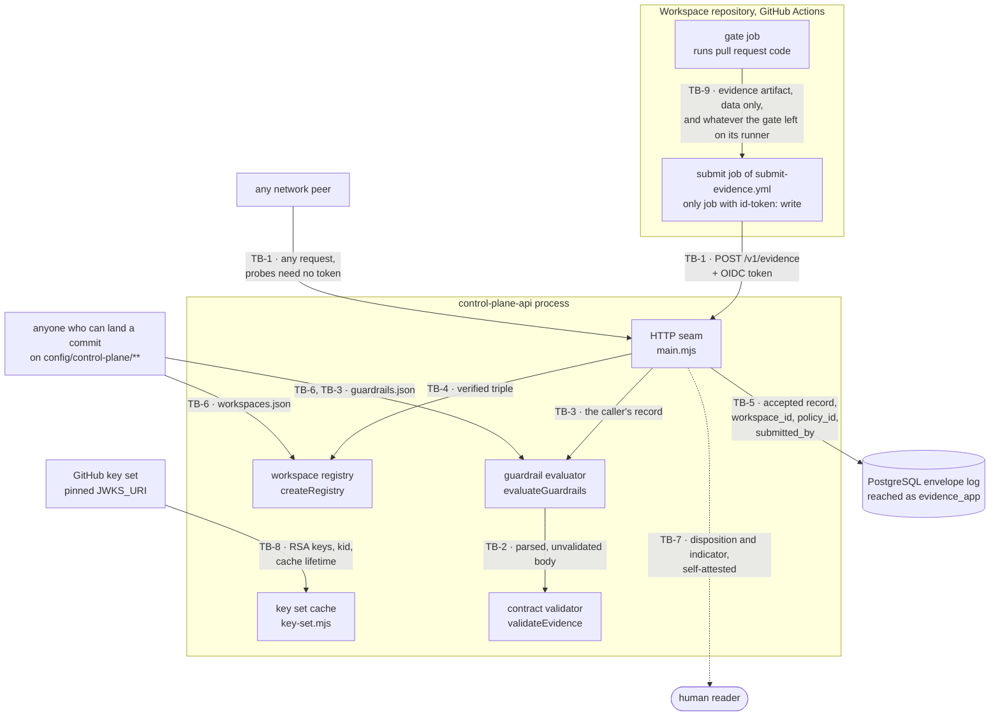

# Trust boundaries

The nine trust boundaries of the threat model, TB-1 to TB-9: who sits on each side and what
crosses each one. Each arrow points from the untrusted side to the trusted side. Abuse cases,
mitigations and residual risks are left out (they are in the threat model's tables), and so is
everything inside a component.

**Legend.** A subgraph is one trust zone: a workspace's Actions run, or the one control-plane
process. Solid arrows are crossings by a request, a process call, a fetch or a file read; the
dotted arrow is TB-7, which has no socket. The probes are `GET /health` and `GET /ready`;
both TB-6 files are read once, at process start. The cylinder is the database, the stadium a person.
The `guardrails.json` arrow carries TB-3 as well as TB-6: TB-3's untrusted side is the caller's
record and a policy file changed out of band. TB-5 is drawn for the append; `GET /v1/indicators`
crosses it too, reading the log back.

| TB   | Untrusted side → trusted side                                              | What crosses (threat model › Trust boundaries)                                   | Decision                                     |
| ---- | -------------------------------------------------------------------------- | -------------------------------------------------------------------------------- | -------------------------------------------- |
| TB-1 | any peer that can open a socket → the request handler in `main.mjs`        | evidence records, technical dispositions, registrations, indicator aggregates    | ADR-0003 (Authorized for W), ADR-0005        |
| TB-2 | a parsed but unvalidated request body → the `evidence/0` subset            | the candidate record, its tier, its affected set, its verification list          | —                                            |
| TB-3 | the caller's record, and a policy file changed out of band → the evaluator | policy rules, the approving decision reference, the disposition returned         | ADR-0004 (ABU-11, MIT-13)                    |
| TB-4 | a verified principal's claim to a workspace → registrations loaded at boot | `repository_url`, `evidence_endpoint`, `owners`, `workspace_id`                  | ADR-0003 (principal to workspace binding)    |
| TB-5 | an accepted but unattributed record → the envelope log, as `evidence_app`  | payload, `(workspace_id, change_id)`, `policy_id`, `received_at`                 | ADR-0002, ADR-0004 (`submitted_by`)          |
| TB-6 | any author who can land a commit on the policy path → policy and registry  | guardrail rules, `policy_id`, the approval reference, workspace registrations    | ADR-0003 (no route administers either)       |
| TB-7 | the control plane's own published claims → a human's understanding         | the meaning of a disposition, the indicator disclaimer, every Done-when claim    | ADR-0004 (every disposition `self-attested`) |
| TB-8 | the network path to and content at the pinned `JWKS_URI` → `key-set.mjs`   | issuer public keys, their `kid`s, and the cache lifetime that bounds their use   | ADR-0003 (keys and rotation)                 |
| TB-9 | the gate job's artifact and runner → the pinned `submit` job               | the evidence record, the runner's ID-token request credential, each minted token | ADR-0003 (what a pin does not do)            |

Two things the picture shows that the threat model's table words differently:

- TB-2 is named "HTTP seam to contract validator". In the code the seam never calls
  `validateEvidence` itself: `evaluateGuardrails` calls it first, so the arrow starts at the
  evaluator. What crosses is the same body.
- TB-1's untrusted side includes the submit job: it is one more peer. It is drawn separately
  because it is the only peer the design expects to carry a token.

## Sources

- `docs/architecture/threat-model.md` › Trust boundaries (the table and the paragraphs under it)
- `docs/adr/0003-github-actions-oidc-workload-authorization.md` › Route authorization, What a pin
  does not do, Keys and rotation
- `docs/adr/0004-evidence-recorded-as-identity-bound-self-attestation.md` › Decision
- `docs/adr/0005-unauthenticated-readiness-probe.md` › Decision
- `packages/control-plane-api/src/main.mjs:92-98` (policy and registry read once at start),
  `:252-428` (routes)
- `packages/guardrail-policy/src/evaluate.mjs:18-21` (`validateEvidence` called first)
- `packages/workload-identity/src/key-set.mjs`, `packages/workload-identity/src/constants.mjs:14-15`
  (`JWKS_URI`)
- `.github/workflows/submit-evidence.yml:18-28` (the one job with `id-token: write`)
- `packages/evidence-store/migrations/0001-evidence-envelope.sql:125-127` (the `evidence_app`
  grants)
